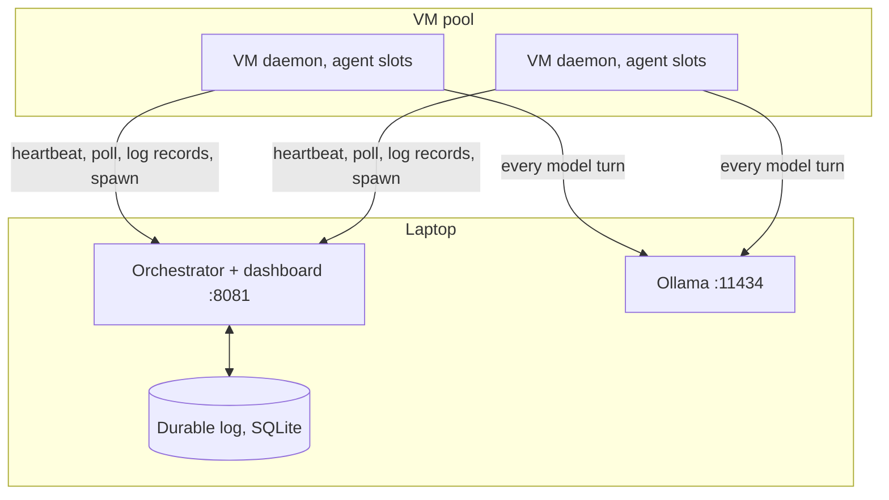

# Agent demo: real coding agents on Durable Swarms

`durable_swarms/` runs *simulated* workflows and is what the benchmarks measure.
This package is a separate demo mode in which the workers are real LLM agents.
It reuses the orchestrator's leases, attempt fencing, placement and recovery, and
adds nothing to the simulation: `durable_swarms` only gained optional arguments on
`serve()` and `run_vm()` and one scheduler hook, whose defaults keep its behaviour
unchanged.



The VMs open every connection; nothing connects into them. Remote VMs reach the
laptop through an SSH reverse tunnel, so on a VM both services are `localhost`.

## How to use it

Everything below is run from the repository root on the laptop.

### 1. Install (once)

You need Python 3.10 or newer and [Ollama](https://ollama.com).

```sh
python3 -m venv .venv
.venv/bin/pip install -r agent_demo/requirements.txt
brew install ollama
```

The model (`qwen2.5-coder:7b`, about 5 GB) is downloaded automatically the first time
you start the demo.

### 2. Start it

Use two terminals and leave both running.

```sh
scripts/demo/laptop_up.sh     # terminal 1: Ollama, the orchestrator and the dashboard
scripts/demo/local_vms.sh     # terminal 2: three VM daemons (vm-1, vm-2, vm-3)
```

Then check that everything is up, and open the dashboard:

```sh
scripts/demo/preflight.sh     # one line per check; ends with "Ready" or names what failed
open http://localhost:8081
```

You should see three green VMs with four free slots each.

### 3. Launch a task

In **Launch tasks** (below the diagram, on the right) press **Launch**. The fields:

| Field | Meaning |
| --- | --- |
| Tasks | How many tasks to start. Each gets its own lead agent and 10 problems. Start with 1: the model is the bottleneck. |
| First seed | Which problems are drawn. The same seed always gives the same 10 problems; the field advances by itself after each launch. |
| Run name | Prefix of the task id (`demo-1`, `demo-2`, …). |
| Model | An Ollama model tag, or blank for the one in `config.json`. |
| Operator instructions | Optional extra guidance given to each lead agent. |

The first task is named Alice. "Alice Lead" appears on a VM, reads its problems and
usually starts three subagents, which start their own. A task takes about three
minutes. The same from a terminal:

```sh
.venv/bin/python -m agent_demo submit --agents 1 --seed 1 --name demo
.venv/bin/python -m agent_demo status demo-1
```

### 4. Watch it

- **Top row**: problems solved, agents running, failures recovered, model calls saved.
- **Live system**: the laptop (model, orchestrator, durable log), the VMs with their
  slots, and one tile per agent. Purple dots are model calls, blue dots are log
  writes. An agent's bar has one segment per problem; green means it passed the
  hidden tests.
- **Trajectory** on an agent tile: every thought, command and command output of that
  agent, live.
- **Agent details** and **Recovery timeline** (below): per-problem results and the
  orchestrator's events.

### 5. Break things

Press a card under **Scenarios**. A card says what it would hit ("Target: VM 2 · 3
agents on it"); a greyed-out card says why it cannot fire yet. A panel opens and
follows what happens step by step. See [Scenarios](#scenarios) for what each one
shows. Practical notes:

- **Crash an agent** and **Crash a VM** need running agents, so launch a task first.
  Nothing visible happens for 10 seconds: that is the lease running out.
- **Crash an agent mid-spawn** only arms itself. Press it *before* launching a task
  (or in a task's first half minute, while agents are still handing work out). It
  fires on the next `spawn_subagent`.
- To pick the target yourself, use **Crash VM** on a VM or **Crash agent** on an
  agent tile.
- **Close** hides the panel; **Show the last walkthrough again** brings it back.
- An agent may fail five times; after that its task is marked escalated.

### 6. Clear and stop

- **Stop & clear** on a task removes that task; **Stop & clear all** empties the board
  and the next task is Alice again.
- To shut down, press Ctrl-C in both terminals. Ollama keeps running in the
  background; stop it with `pkill -f "ollama serve"`.
- The board is stored in `agent_demo.sqlite3`. It survives a restart; delete the file
  (with the orchestrator stopped) for a completely fresh start.

### 7. Put a VM on a remote machine (optional)

A remote machine needs SSH access, `rsync` and Python 3.10 or newer; no sudo. The
example moves `vm-3` to `user@host`.

```sh
ssh-copy-id user@host                       # once: key-based login
scripts/demo/local_vms.sh vm-1 vm-2         # terminal 2: run only two VMs locally
scripts/demo/setup_vm.sh user@host          # copy the repo to ~/Durable-Swarms there and install
scripts/demo/tunnel.sh user@host            # terminal 3, leave running
scripts/demo/start_vm.sh user@host vm-3     # start the daemon on the remote machine
```

The tunnel makes the laptop's orchestrator (8081) and Ollama (11434) reachable as
`localhost` on the remote machine, so every model call still runs on the laptop.
VM 3 turns green in the dashboard and is used like the others. Then:

```sh
scripts/demo/stop_vm.sh user@host vm-3      # a real kill: VM 3 goes red after 10 s, its agents move
scripts/demo/start_vm.sh user@host vm-3     # bring it back
```

Run `setup_vm.sh` again after changing code. The daemon's log on the remote machine
is `~/Durable-Swarms/.runtime/vm-3.log`. VM ids must be ones listed in
`agent_demo/config.json`, which also holds the slot counts, the model and the limits.

### If something is wrong

| Symptom | Cause and fix |
| --- | --- |
| `preflight.sh` prints a FAIL line | It names the missing piece: start `laptop_up.sh`, start the VM daemons, or install the requirements. |
| "another orchestrator is using this database" | One is already running. Stop it: `pkill -f "agent_demo orchestrator"`. |
| A VM stays offline | Its daemon is not running, or for a remote VM the tunnel dropped (it reconnects by itself). A daemon restarted within 10 s of the old one dying waits for the old lease to run out, then registers. |
| Agents are very slow | Too many agents share the model. Run one task at a time. |
| Every agent is recovered at once | The laptop slept, so every lease ran out. `laptop_up.sh` prevents sleep while it runs. |
| A scenario card is greyed out | It says why underneath, usually that no agent is running. |

## What runs

- **Workload**: one lead agent given 10 problems (4 easy, 4 medium, 2 hard) sampled
  by seed from a bank of 30 LeetCode-style problems. Statements are our own
  wording; every problem has example tests the agent can run and hidden tests it
  is graded on.
- **Agent**: a [mini-swe-agent](https://github.com/SWE-agent/mini-swe-agent) loop.
  The model's only tool is bash: it reads `problems/<id>/PROBLEM.md`, writes
  `solution.py`, and runs `test_visible.py`.
- **Subagents**: an agent may run `spawn_subagent --problems a,b`, `subagent_status`
  and `wait_subagents`. The task prompt (`prompts/instance.j2`) encourages an agent
  with several problems to split them between subagents and shows the command for
  doing so. It is still the model's decision: nothing in the code spawns for it and
  there is no fallback policy. One agent may start at most 3 subagents
  (`max_children`), and subagents can start their own (depth limit 2), so a lead with
  10 problems typically becomes a tree of 3 subagents and up to 9 below them. An agent
  that waits gives up its VM slot and is rescheduled when its subagents finish.
- **Reporting back**: when its subagents have finished, an agent is told each
  problem's hidden-test result. If a subagent handed a problem on again, the result
  is the best one reached anywhere below it.
- **Checking**: when an agent says it is done, the orchestrator grades its solutions
  on the hidden tests. If a problem still fails (and no finished subagent solved it),
  the agent is sent back to work with the failing problems and one failing input
  each, at most `max_reviews` (2) times. An agent with subagents still running is
  paused until they finish before it is checked.
- **Scoring**: each problem counts as solved if any agent that held it passed all
  hidden tests.

## Dashboard

`http://localhost:8081/` shows the running system in three layers, joined by live wires:

1. **Your laptop**: the model (recent and in-flight requests), the orchestrator, and
   the durable log.
2. **VM pool**: each VM and its agent slots. Dots on the wires are real traffic since
   the last second: prompts to the model, replies, log writes, assignments, heartbeats.
3. **Agents**: one group per task, with each agent's progress (for example 4/10) and a
   line to the VM slot it is running in. The bar has one segment per problem.

Tasks are named Alice, Bob, Charlie, … in submission order. Each has an "Alice Lead"
and any subagents it starts are "Alice Sub 1", "Alice Sub 2", …; VMs are "VM 1",
"VM 2" in configuration order. These are display names; ids such as `agent.1` and
`vm-1` remain the identities used by the protocol and the CLI.

**Stop & clear** on a task stops its agents and removes the run from the board
(`/clear_runs`). **Stop & clear all** does this for every run, so the next launch is a
fresh round that starts again at Alice. Clearing deletes those runs' records.

### Scenarios

The dashboard is a sandbox: launch tasks and start any scenario at any time, in any
order, on any target. Each scenario is a card that says what it does and what it
shows, and names what it would act on right now ("Target: VM 2 · 4 agents on it").
A card that cannot fire is greyed out and says why.

| Card | What it does | What it shows |
| --- | --- | --- |
| **Crash an agent** | Kills one running agent's process (`/crash_agent`); its VM stays healthy | Detection by lease, rebuild from the log, no model call repeated |
| **Crash a VM** | Power loss (`/crash_vm`): every agent on the VM dies; it rejoins after `crash_seconds` (20 s) | Many recoveries at once, using the slots kept free for recovery |
| **Crash an agent mid-spawn** | Kills the next agent that runs `spawn_subagent`, right after the spawn's receipt is stored | Exactly-once: the re-run command gets the same subagent back |
| **Follow a subagent spawn** | Nothing; follows the most recent spawn | How a subagent comes to exist and reports back |

**Crash VM** on a VM and **Crash agent** on an agent start the same scenarios for the
target you pick. **Lifecycle** on a subagent in "Agent
details" follows that subagent's spawn.

Starting a scenario opens a walkthrough panel beside the diagram:

- a "What this shows" line, and an outline around the VM and agents it concerns;
- each step with the time it happened, read from the orchestrator's events, the
  agent log and lease times (`/demo/drill`); none of it is scripted;
- a result line when it is over, for example "Bob Sub 7 was back at work 17s after
  the failure. 4 model replies (64s of model time) came from the log and none were
  requested again";
- the other walkthroughs of the session, to switch between them.

The orchestrator is never told about an injected failure. It finds out as it would in
production: the VM's (or the agent's) lease is no longer renewed by heartbeats and
runs out after `lease_seconds` (10 s). Recovery then goes through the same steps
every time: the dead attempt is fenced, the restart is approved (by the orchestrator
for a lead, by the parent agent for a subagent), a new attempt is placed on a VM,
that VM starts a process, the process replays the durable log, and the agent logs its
next turn.

**Crash an agent mid-spawn** is armed first and fires on the next `spawn_subagent`
from any agent. The agent dies after the orchestrator has stored the receipt and
before the agent can log the command's result. Rebuilt from a log that ends with the
command, it runs the command again; the operation id is the same, so it is handed
the subagent that already exists.

The **Model calls saved** number at the top is the total, over all recoveries, of
model replies that were taken from the log instead of being requested again.

Below the diagram are per-problem details, each agent's full trajectory, a launch
form, and the timeline of recovery events.

## Slots kept free for recovery

The scheduler does not fill the pool. With `recovery_reserve: 2`, ordinary work (a
new subagent, or an agent resuming after a pause) is placed only while more than two
slots are free across the live VMs. Recovery work may take any free slot and goes
first: that is an agent whose last attempt was lost, and any agent that has to run
to approve such a restart. An agent held back by this rule says so on its tile. If
nothing is running at all, the reserve is waived so a small pool cannot stall.

The policy is `AgentEngine.placeable`; the simulation's scheduler calls the same hook
with a default that places everything, so its behaviour is unchanged.

## Why an agent survives losing its VM

| Durable fact | Where | Effect on recovery |
| --- | --- | --- |
| Every model reply, before its command runs | `agent_log` | A logged reply is never requested again |
| Every command result, with the files it changed | `agent_log` | The workspace is rebuilt on any VM |
| Spawn receipt keyed by (agent, turn, index) | `spawns` | Re-running a spawn command cannot create a second subagent |
| Result graded by the orchestrator | workload checkpoint | A finished agent is never re-run |

A replacement attempt rebuilds the conversation and files from the log and
continues at the next turn. If the VM died after a reply was logged but before its
command's result was, only that command runs again. Requests from the old attempt
are rejected with HTTP 409, exactly as in the simulation.

## Presenting it

Nothing in the dashboard enforces an order. This path covers every property in about
five minutes; one task takes roughly three minutes to finish on a laptop.

1. Before you start, run one task to completion and leave it on the board, so there
   is a finished scorecard to point at. Run `scripts/demo/preflight.sh`.
2. Press **Crash an agent mid-spawn** (it arms), then launch one task. While the lead
   reads its problems, point out the laptop (model, orchestrator, durable log), the
   VM pool, and the wires: purple dots are model calls, blue dots are log writes, and
   a reply is logged before its command runs.
3. The armed scenario fires on the lead's first spawn. Walk down the panel: receipt
   stored, agent killed, lease runs out, agent rebuilt, same command run again, same
   subagent returned.
4. Click an agent's **Trajectory** to show a real agent thinking, running commands and
   reading test output.
5. Press **Crash a VM**, or let someone choose a VM. The ten seconds of silence are
   the point: the orchestrator cannot tell a dead VM from a slow network. Then every
   agent that was on it is rebuilt elsewhere, using the slots kept free for recovery.
   For a real kill, run `scripts/demo/stop_vm.sh user@host vm-3` (or Ctrl-C a local
   daemon) and watch the diagram and the recovery timeline.
6. Open a recovered agent's trajectory from the walkthrough ("see trajectory"): the
   red divider marks where the new VM took over, and the turn counter continues.
7. Close on **Model calls saved**, the finished scorecard, and the simulation's
   benchmark numbers.

Questions to expect:

- *Is the orchestrator a single point of failure?* It is a single process, but it
  holds nothing that is not in SQLite. If it is killed and started again, it reads
  its state back and gives every lease that was still valid one fresh lease period,
  so running agents carry on. It is not replicated; that would take a replicated log
  in place of one SQLite file.
- *What if a command had side effects and runs twice?* A command that was running
  when its agent died runs again. Spawning is made safe by its operation id; file
  edits are safe because the workspace is restored first. Arbitrary external side
  effects would need the same receipt treatment.
- *Why ten seconds?* The lease trades detection time against false alarms. A pause
  shorter than the lease costs nothing; a longer lease delays every recovery.
- *How do you know it is not scripted?* Every walkthrough step is read from the event
  log, and the audience can pick the target.

Fallback if the network fails: run everything locally as above.

## Layout

| Path | Purpose |
| --- | --- |
| `engine.py` | `AgentEngine(Engine)`: dynamic spawn, durable agent log, suspend/wake, scoring, restart grace, failure injection, scenario walkthroughs, dashboard state |
| `runtime.py`, `agent.py`, `llm.py` | Worker process, durable mini-swe-agent subclass, Ollama model with telemetry |
| `tools/` | `spawn_subagent`, `subagent_status`, `wait_subagents` shell commands |
| `problems/` | `defs.py` + `references.py` → `build_bank.py` → `bank.json`; `bank.py` samples and lays out workspaces |
| `sandbox.py`, `grade_runner.py` | Resource-limited grading subprocess |
| `static/` | Dashboard |

Rebuild the bank after editing problems: `python3 -m agent_demo.problems.build_bank`.
It checks each reference solution against hand-written examples and an independent
brute-force oracle on random inputs.

## Tests

```sh
.venv/bin/python -m unittest discover -s tests -v
```

`test_agent_demo_e2e.py` needs mini-swe-agent and is skipped under an interpreter
without it. It runs real orchestrator, daemon and agent processes against a scripted
stand-in for Ollama. One test each kills the VM hosting a subagent, kills the lead
in the middle of a spawn, and kills the orchestrator with SIGKILL and restarts it.
Each checks that no logged turn is requested from the model twice.

## Limits

- The sandbox limits CPU, memory (Linux) and time, and agents run bash as the VM
  user. That is containment for a demo on trusted machines, not a security boundary.
- The orchestrator does the grading, but `bank.json` (with the hidden tests) is also
  on each VM's disk, so an agent could read it.
- A command that was running when its VM died runs again on recovery. Commands
  here only edit workspace files and call idempotent spawn, so this is safe; it
  would not be for arbitrary external side effects.
- Small models loop. A repeated identical command gets a warning in its output, and
  each agent has a turn limit; an agent that hits it is graded on what it wrote.
- The orchestrator's clock must keep running. If the laptop sleeps, every VM lease
  expires on wake and running agents are recovered. `laptop_up.sh` runs the
  orchestrator under `caffeinate` to prevent this. (A restarted orchestrator is
  different: it gives every lease that was still valid one fresh lease period.)
- An agent rides out an orchestrator outage for about a minute of retries; after
  that its process gives up and the agent is recovered normally.
- A subagent's restart is approved by its parent, which needs a VM slot to do so. The
  scheduler keeps `recovery_reserve` (2) slots free for this and for the restarts
  themselves; if a failure needs more than that, the rest waits for a slot.
- Each agent may fail `max_attempts` (5) times; the fifth failure escalates its run.
  Crashing the same agent repeatedly will reach that limit.
- The API is unauthenticated, as in the simulation: keep it on localhost and tunnels.
