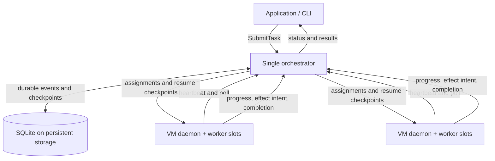

# Architecture and implementation

## Scope

This implementation runs simulated workflows on a fixed pool of existing machines.
Each workload has one logical leader and zero or more subtask workers. A worker is
a disposable Python subprocess; a VM daemon can host several workers up to its
configured slot count. The same daemon can run on separate VMs or as separate
processes on one development machine.

The application submits a JSON workflow and reads its status/result. It does not
handle placement, leases, retries, or recovery. There are no LLM dependencies.
The simulator supplies the application logic: compute delays, dependency handling,
counter effects, and declared results.



## Components and ownership

- `spec.py`: validates the workflow dependency DAG and expands seeded delays.
- `store.py`: SQLite transactions, append-only event log, workload snapshots,
  VM records, effect receipts, and the simulated counter world.
- `engine.py`: scheduling, state transitions, leases, attempt fencing, child
  recovery authorization, checkpoints, and idempotent effects.
- `server.py`: JSON HTTP API and periodic scheduling/monitoring loop.
- `runtime.py`: VM registration, heartbeats, assignment polling, process lifecycle,
  and execution of simulated steps.
- `client.py` and `__main__.py`: HTTP client and command-line entry points.

The orchestrator detects infrastructure and progress failures for every worker.
It directly queues replacement leaders. Failed children enter `needs_recovery`;
their leader's `/manage` call authorizes the replacement. This gives the leader
responsibility for child recovery without requiring a leader to infer VM health.
The orchestrator still performs placement and enforces attempt fencing.

When a leader finishes its own steps, it yields its slot while waiting for
children. A child failure or completion of all children makes the leader runnable
again. It receives completed child results through `/manage`, and the final
workload result contains both the leader result and all child results. Yielding
is not a failure and does not consume the recovery budget.

## State and scheduling

Workloads start `queued`, become `running`, enter `recovering` after a failure,
and return to `running` as replacement attempts start. Terminal states are:

- `completed`: every declared worker completed and the leader collected results.
- `failed`: a worker reported an invalid or premature final result.
- `escalated`: recovery exhausted its configured failed-attempt budget, or a
  durable effect receipt conflicts with the recovery state.

Workers move through `queued → assigned → running → completed`. Leaders can
yield into `waiting`; failed children use `needs_recovery`. Each assignment gets
a monotonically increasing attempt ID. The log records superseded attempts,
failure reports, and replacement assignments; it retains their history even
though the current-state projection contains only the latest attempt.

The scheduler allocates at most one ready worker per workload per pass, repeating
while capacity remains. Dependencies must be completed before a subtask is ready.
Placement prefers a live VM other than the failed worker's previous VM, then the
least occupied VM by configured capacity. If only the original VM is available,
it can host the replacement. Each assignment reserves a slot; waiting, completed,
and superseded attempts release their slot. Daemons terminate subprocesses that
are no longer assigned to them.

VM heartbeats renew the VM lease and only the worker attempts the daemon reports
as still alive. A separate progress timeout catches stalls and repeated reports
with no advancing progress. Assignments expire if a daemon never starts them.
All request validation uses the orchestrator's clock, VM session, current attempt,
and lease expiry. Workers cannot renew or write through an expired lease.

## Durable state and replay

SQLite uses WAL mode and `synchronous=FULL`. Mutations commit under a transaction
and are acknowledged only after commit. Events include a global sequence number,
workload ID, worker ID/attempt/parent when applicable, timestamp, workload state
version, type, and payload. Workload-wide snapshot events have no worker ID.

Every state-changing transaction appends a checkpoint containing the workload's
current state, including each worker's next incomplete step. The `workloads` table
is a materialized view of these checkpoints and is rebuilt from the event log on
orchestrator startup. Checkpoints persist at step boundaries; progress within an
unfinished delay step is observable but may be repeated after recovery.

Effects are simulated counter increments, scoped to a workload. Their operation
ID is a hash of `(workload ID, logical worker ID, step index)` and excludes the
attempt and VM. The protocol is:

1. Commit an `effect_intent` event before applying an effect.
2. Apply the counter mutation, store its unique receipt, and append its completion
   event in one SQLite transaction. Repeated requests return the original receipt.
3. Commit the worker's step checkpoint only after the receipt exists.

After a crash between steps 2 and 3, the replacement retries the same operation
ID, receives the existing receipt, and advances the checkpoint. Completed steps
are skipped. A crash before step 2 leaves no receipt and no mutation, so the
operation can be applied safely. There is no distributed transaction here: the
simulated effect destination and its receipt registry share a local transaction.

```mermaid
sequenceDiagram
    participant W as Worker attempt 1
    participant O as Orchestrator + durable store
    participant R as Worker attempt 2 on another VM
    W->>O: Commit effect intent
    W->>O: Apply effect with stable operation ID
    O->>O: Atomically commit mutation + receipt
    Note over W: Crash before step checkpoint
    O->>O: Lease expires; fence attempt 1
    O->>R: Assign latest checkpoint with attempt 2
    R->>O: Retry same effect operation ID
    O-->>R: Original receipt; no second mutation
    R->>O: Commit next-step checkpoint
```

An old attempt's status, progress, effect, or checkpoint request is rejected with
HTTP 409. Administrative stop/recreate operations fence assignments before their
replacement is placed. Checkpoint retries and submission retries with the same
task ID are idempotent. Generic effects on external services are outside the
implemented simulator: the counter guarantee does not imply exactly-once
execution for arbitrary external tool calls.

## HTTP interface

All writes use JSON objects. Worker calls include `task_id`, `worker_id`,
`attempt`, `vm_id`, and `session`; VM calls include `vm_id` and `session`.

| Endpoint | Purpose / additional fields |
| --- | --- |
| `POST /submit` | `spec`, optional stable `task_id`; create a workload |
| `GET /status?task_id=...` | Current state, workers, checkpoints, results, effects |
| `GET /events?task_id=...` | Ordered log; optional `worker_id`, `after`, `limit` |
| `GET /vms` | VM sessions, capacity, and lease expiry |
| `GET /health` | Process readiness |
| `POST /register` | Join a configured VM to the pool with a unique session |
| `POST /heartbeat` | Renew VM and listed `active` worker attempts |
| `POST /poll` | Get current assignments and their resume checkpoints |
| `POST /start` | Acknowledge an assigned attempt |
| `POST /manage` | Leader spawns declared children, authorizes retries, collects results |
| `POST /progress` | Advance `step` / integer `progress` |
| `POST /intent` | Commit simulated effect intent for `step` |
| `POST /effect` | Apply or return receipt for effect at `step` |
| `POST /checkpoint` | Complete `step` and persist the next-step cursor |
| `POST /finish` | Report expected `result`, or yield leader until children finish |
| `POST /fail` | Report failure with `reason` |
| `POST /stop` | Operator fences `task_id` / `worker_id` and initiates recovery |
| `POST /recreate` | Fence a `vm_id`, retire its session, allow service re-registration |

`/manage` implements the simulator's spawn interface from the declared workflow
specification. Subtask dependencies and parent result delivery supply the needed
communication; there is no additional arbitrary message broker.

The recreate operation resets a VM's worker service. A live daemon terminates its
old processes and re-registers with a fresh session. A dead VM must be restarted
by its operator or existing VM manager, then its daemon can rejoin. This project
does not provision cloud VMs or include a provider-specific reboot adapter.

## Simulation and operation boundaries

The workflow log stores the seed, normalized durations, and fault schedule.
Faults target a logical worker, assignment attempt, and zero-based step. Supported
kinds are `worker_exit`, `vm_loss`, `stall`, `retry_loop`, `invalid_result`, and
`effect_interruption`. VM loss exits the daemon and its subprocesses; it does not
power off the host. Fault schedules and simulated outputs are reproducible;
concurrent scheduling order and elapsed recovery time are not deterministic.

One orchestrator serves a small trusted cluster. A local advisory lock prevents
multiple server processes from opening the same database. SQLite and its WAL must
remain on durable storage accessible to the orchestrator after restart. Worker
VMs keep no required durable state. Loss of the database or its underlying disk
is outside the recovery guarantee. Timeouts assume a stable orchestrator clock.

The API is unauthenticated and intended for loopback or a trusted private VM
network. Workload effects and state are logically separated by task ID; this is
not hostile multi-tenant isolation. Full checkpoint events and heartbeat history
favor an inspectable implementation; log compaction and large-cluster capacity
have not been implemented or claimed.
